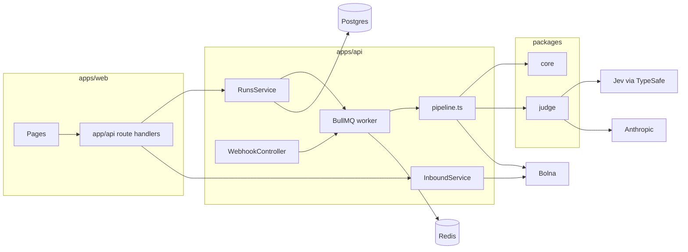
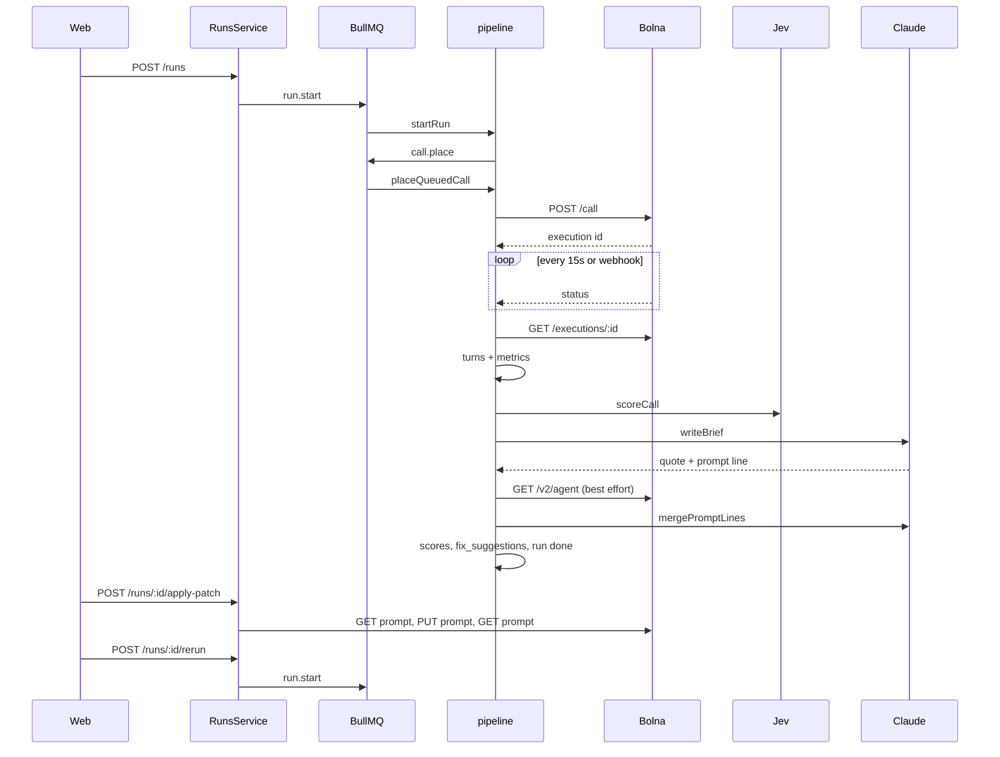

# Kasauti as it is

Read from the repo on 4 Nov 2026. Paths are relative to the git root `kasauti/`. Older product notes in `docs/*.md` are not this map. Where the code does not say, the question is listed at the end.

## Packages

| Piece | Path | Responsibility |
|---|---|---|
| Web | `apps/web` | Next.js UI. Pages call Next route handlers under `apps/web/app/api/**`, which proxy to the API. Browser session lives in `sessionStorage` (`apps/web/lib/prototype.ts`). No server account. |
| API | `apps/api` | NestJS. Modules: `DbModule`, `QueueModule`, `RunsService`, `InboundService`, `WebhookService`. Entry `apps/api/src/main.ts`. Port from `PORT` (default 3001). |
| Core | `packages/core` | Manifest and persona schemas, caller brief, Bolna transcript parse, metrics, green/amber/red. |
| Judge | `packages/judge` | Jev scores (`jev.ts`), quote check, Claude brief and patch (`claude.ts`). |
| Content on disk | `personas/*`, `demo-target/*.manifest.json` | What a run actually loads. |
| Scripts | `scripts/` | One-off dial, inspect, score, patch, suite build. Not on the request path. |
| Unused by the API | `domains/clinic.json`, `domains/lender.json` | Read only by `scripts/specialize.ts`. |

The API imports core and judge by relative path (`apps/api/src/queue/pipeline.ts`), not through the package exports.

Postgres is Drizzle (`apps/api/src/db/schema.ts`, client pool max 5 in `db.module.ts`). Redis is BullMQ (`queue.service.ts`, prefix `kasauti`, queue name `runs`).

## One run, step by step

One run is one target and a list of personas. The create body allows at most 8 persona ids (`createSchema` in `runs.service.ts`). There is no second bot in the same run, and no sampler.

| Step | What happens | Where |
|---|---|---|
| 1. Create | Zod-parse the body. Consent required unless `fixtures` is set. Optional shared-line switch. Upsert `targets` by phone. Insert `runs` and one `calls` row per persona. Enqueue `run.start`. | `RunsService.create` |
| 2. Caller brief | If a manifest slug resolves, `callerBrief(profile, manifest)` fills `calls.user_data`. Otherwise the call row stores `{}`. | `packages/core/src/caller-brief.ts` |
| 3. Start | Status `running`. Enqueue `call.place` for the first `MAX_CONCURRENT_CALLS` pending rows, 20s apart when not a fixture. | `pipeline.startRun` |
| 4. Place | Skip if this call already has an execution id, a provider ref, or a verdict. Skip if this run already has that many in-flight calls. Else `POST /call` on Bolna with the caller agent id, the target phone, `user_data`, and `bypass_call_guardrails`. The dial goes through `CallerEngine`. The row stores `provider_ref` and `bolna_execution_id` as the same value. A retry that already has the ref does not dial again. | `placeQueuedCall`, `queue/bolna-engine.ts` |
| 5. Talk | Bolna runs the caller agent. The target is whoever answers that phone. Kasauti does not sit in the audio path. | Bolna |
| 6. Progress | `POST /webhooks/bolna?s=` stores the body and, on a terminal status, enqueues ingest. A watchdog polls `GET /executions/:id` every 15s for 8 minutes. | `webhook.controller.ts`, `watchCall` |
| 7. Transcript | Flat Bolna string. `assistant` is the caller, `user` is what the caller heard. Rows go to `turns`. | `packages/core/src/transcript.ts`, `ingestCall` |
| 8. Score | One Jev `systemOne` call, seven dimensions. Verdict from critical dimensions. | `judgeCall`, `packages/judge/src/jev.ts`, `packages/core/src/verdict.ts` |
| 9. Failing line | Claude `writeBrief` returns a sentence, a quote, a turn index, and one prompt line. A second Jev call keeps the quote only when it "supports" the sentence. | `claude.ts` `writeBrief`, `quoteSupportsFailure` |
| 10. Patch text | If the verdict is not green, Claude writes a block. The prompt it sees is the live Bolna system prompt when the agent id reads, else `targets.task_goal`. | `buildCallerBlock`, `mergePromptLines` |
| 11. Apply | Separate HTTP call. Off unless `PATCH_ENABLED` is exactly `true`. Read live prompt, replace or append, PUT, read back, check a 48-character marker. | `applyRunPatch` / `applyCallPatch`, `patch/patch.ts` |
| 12. Rerun | New run, `parent_run_id` set, `rerun_scope` `full` or `caller`. Copies `user_data` with the fixture flag removed, so Bolna dials again. | `rerun`, `rerunCall` |
| 13. Compare | `GET /runs/:id/merged` walks the parent tree and keeps other callers when only one was redialed. | `getMerged` |

## Data model

Tables in `apps/api/src/db/schema.ts`:

| Table | Role |
|---|---|
| `targets` | One row per phone. `owner_email`, `platform` check (`bolna`, `vapi`, `retell`, `elevenlabs`, `other`), `bolna_agent_id`, `task_goal`, `facts` jsonb, consent time, shared-line lock columns. |
| `persona_agents` | `persona_id` → Bolna caller agent id. Read in `agentIdFor`. No insert anywhere in `apps/` or `packages/`. |
| `runs` | Target, label, parent, `rerun_scope`, status, `pass_rate`, unused `share_token`. |
| `calls` | Persona, `user_data`, `bolna_execution_id`, `provider_ref` (same value), `channel` (`voice`), status, attempt, `execution_raw`, `target_execution_raw`, recording key, duration, cost, hangup, ttfa, verdict. |
| `turns` | `(call_id, idx)`, speaker `persona` or `target`. |
| `call_metrics` | Turn counts, Hindi ratio, raw jsonb. Latency columns exist. Ingest writes the turn counts only. |
| `scores` | Dimension, 0–5 or null, verdict, evidence jsonb, `judge_version`. Primary key includes `judge_version`. |
| `fix_suggestions` | Per run. `dimension` `prompt` (one line) or `block` (Claude's block). |
| `webhook_events` | Raw Bolna payloads. |

`calls.target_execution_raw` is never written. The judge sees only the caller agent's transcript.

### Where content lives

| Kind | Live path | Also exists, not on the request path |
|---|---|---|
| Persona shape | `personas/<slug>/profile.json`, schema in `packages/core/src/manifest.ts` | `archetype.json`, `archetype.md`, `agent.json`, `welcome.txt`, `prompt.md` |
| Caller agent id | `personas/<slug>/.agent_id`, else `persona_agents`, else `PERSONA_AGENT_ID` for `angry_uncle` only | |
| What the caller says | `callerBrief()` in `packages/core/src/caller-brief.ts`. The per-topic ask sits on the manifest topic. | `prompt.md` is what gets pushed to Bolna by `scripts/update-caller-prompts.ts` and `RunsService.pushCallerPrompt` (Sharma ji only, `assertSharma`) |
| Desk facts, scope, never-say | `demo-target/<slug>.manifest.json` | `domains/*.json` for the specialize script |
| Category → desk | `vertical` on the manifest, read through the catalog | |
| First prompt draft | `seed_prompt` on each manifest. Sehat and RupeeSetu keep the short v1 drafts. Swaad, Nila, and Nivas keep the role sentence. | `apps/web/lib/agent-briefs.ts` |
| Rubric | Seven questions in `packages/judge/src/rubric.ts`, loaded as rubric `default`. Critical stays on the persona. | |
| Display names | `CALLER_NAME` in `runs.service.ts` | |

`manifestSlugOf` matches a fixed list of display names (`packages/core/src/manifest.ts`). An unknown name does not load a manifest, so the brief is empty and the patch block is skipped (`buildCallerBlock` returns `""`).

## External systems

| System | How | Used for |
|---|---|---|
| Bolna callers | `BOLNA_API_KEY`, `POST /call`, `GET /executions/:id` | Dial, status, transcript, recording URL, `total_cost` |
| Bolna desks | `DEMO_BOLNA_API_KEY`, `GET/PUT /v2/agent/:id`, `GET /phone-numbers/all` | Live prompt, transcriber, hangup settings, which agent holds the shared number |
| Jev | `TYPESAFE_API_KEY`, model `jev-latest`, `systemOne` | Seven scores in one call, plus the quote-support choice |
| Claude | `ANTHROPIC_API_KEY`. Patch model `ANTHROPIC_PATCH_MODEL` or `claude-opus-4-1`. Brief uses `ANTHROPIC_MODEL` or `claude-sonnet-4-5` | `writeBrief`, `mergePromptLines`. `judgeSecurity` is only called from scripts |
| Postgres | `DATABASE_URL` | All run state |
| Redis | `REDIS_URL`, default `redis://127.0.0.1:6379` | BullMQ only |
| Telephony | Not called directly. The number is Bolna's | One shared demo number, switched by `InboundService.switchTo` when `NUMBER_SWITCH_ENABLED` is `true` |

`placeCall` sends `bypass_call_guardrails: true`.

Cost stored on the call is `total_cost / 100` (`centsToCost` in `pipeline.ts`). Confirmed 2026-11-07: Bolna's `total_cost` is US cents. One credit on the dashboard is one cent. The raw number is not rupees and not dollars.

Bolna's execution reference says `total_cost` is "the total cost incurred by this execution in cents," and that `cost_breakdown` is in cents. The dashboard shows those same figures as credits. A live re-read of calls already placed agrees, and no new call was placed for this check. A completed 90-second call came back `total_cost` 9, which is 1.5 minutes at the published 6¢/min. The 174-second phase-0 call came back 18, against 17.4¢ at that rate. A rupee reading does not fit: ₹5.52/min for 1.5 minutes is ₹8.28, not 9. `GET /user/me` returns `wallet` as a whole number of those same credits.

`centsToCost` already matches this unit. It was not changed.

`cost_breakdown.total_cost_to_deduct` is the wallet line. Bolna documents that it can differ from `total_cost`. On the re-read it was lower, and on the phase-0 call it was negative. `billing_settled` was still false. The column we store is the call total, not that deduction.

## Concurrency

| Knob | Value in code | Effect |
|---|---|---|
| Worker | `concurrency: 2`, lock 180s | Two jobs of any type at once, process-wide |
| `MAX_CONCURRENT_CALLS` | Default 3 if unset. `.env.example` sets 1 | How many `call.place` jobs `startRun` enqueues, and how many in-flight calls one run may have |
| In-flight check | Filtered by `run_id` | Two runs do not count each other's live calls |
| Shared line | `targets.line_lock_*`, 30 minute occupy, 2 minute claim gap | One run at a time on that phone. A lock with no run row expires after 2 minutes. A run that is not `done` holds it |
| Per-number call serialization | None inside a run | With `MAX_CONCURRENT_CALLS` above 1, one run can dial the same phone more than once at once |
| Daily cap | `DAILY_CALL_CAP` default 40, and 3 runs per target | Both are behind `CALL_CAPS_ENABLED = false` in `runs.service.ts` |
| `ALLOWED_NUMBERS` | Enforced in `assertAllowed` | Create and the script dialer refuse other numbers |
| Retries | Job attempts 3, exponential 5s. `no-answer` and `busy` redial once after 60s | |
| Stuck place | If in-flight is already at the cap, `placeQueuedCall` returns without re-enqueue | The pending row waits for `placeNext` after another call finishes |

`releaseSharedLine` clears the lock only when the run status is already `done`. `finalizeRun` then calls `clearSharedLine`. A run left in `scoring` holds the phone until the 30 minute occupy window.

## Config and secrets

From `apps/api/src/env.ts` and `.env.example`. Required at boot: `DATABASE_URL`, `WEBHOOK_SECRET`. Empty string is allowed for both Bolna keys, which fails later at call time.

| Name | Role |
|---|---|
| `BOLNA_API_KEY` / `DEMO_BOLNA_API_KEY` | Callers / desks. Separate accounts |
| `BOLNA_BASE_URL` | Default `https://api.bolna.ai` |
| `ALLOWED_NUMBERS` | Dial allow-list |
| `SEHAT_AGENT_ID`, `DEMO_AGENT_ID` (Rupeesetu), `SWAAD_AGENT_ID`, `NILA_AGENT_ID`, `NIVAS_AGENT_ID` | Desk agent ids |
| `PERSONA_AGENT_ID` | Fallback for `angry_uncle` only |
| `TYPESAFE_API_KEY`, `ANTHROPIC_API_KEY`, optional model names | Judge and patch |
| `PATCH_ENABLED`, `NUMBER_SWITCH_ENABLED` | Exact string `true` |
| `MAX_CONCURRENT_CALLS`, `DAILY_CALL_CAP` | See above. Daily cap is compiled off |
| `WEB_ORIGINS` | CORS, plus localhost:3000 always |
| `KASAUTI_API_URL` | Web proxy target. Not read by the API |
| `NEXT_PUBLIC_SITE_URL` | Public links. Web only |

There is no auth guard on `RunsController`. `GET /runs/:id`, `GET /calls/:id`, and `GET /calls/:id/recording` are open to anyone who has the id. The webhook checks `?s=` with `timingSafeEqual`.

The web "account" is `sessionStorage` (`prototype.ts`). `owner_email` is whatever the create body sends, or `local@kasauti.dev`.

## Open questions

- Which Bolna field the desk model actually speaks: `agent_prompts.task_1.system_prompt`, `composition_by_language.en`, or both. The apply path writes both (`runPatch`).
- Whether `persona_agents` has rows in production. The API never inserts them. Boot logs only the `.agent_id` files (`main.ts`).
- Whether `call_metrics.latency_p50_ms`, `latency_p95_ms`, and `max_dead_air_ms` were meant to be filled from `execution_raw`. Ingest does not set them.
- Whether `runs.share_token` was meant to gate public reads. The column is unused and the reads are unauthenticated.
- How a customer's own Bolna key on the own-agent page (`apps/web/app/api/bolna/read`) relates to the API's `DEMO_BOLNA_API_KEY`. The page sends the key to a Next route. The dial path uses the server keys only.
