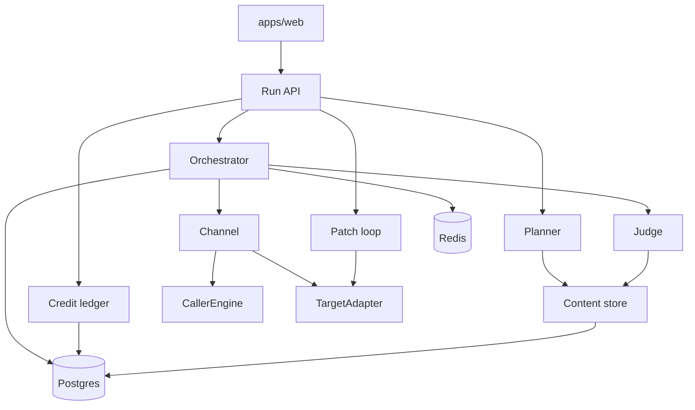
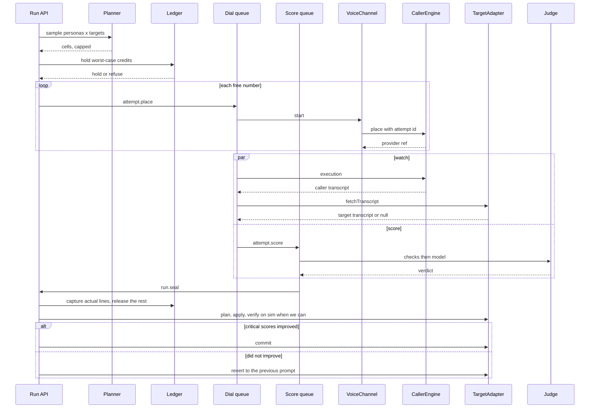

# Target architecture

## What changed in this pass

- A string-specific dimension is scored on the target transcript, or marked unverifiable. It is not failed from the caller-side text.
- `sim` is a channel now: text caller versus text desk, for iteration and a free preview. WhatsApp stays later.
- A patch is verified by rerunning the failing persona, then committed or reverted. Growth is capped. In-place section edit wins over append.
- Auth and tenancy gate the first paid customer, even if the build of tenancy stays later in the migration.
- The quote check folds into the one judge call. The patch uses the cheaper model unless a retry or a hard flag asks for Opus.
- The seven founder decisions are recorded as decided. Bolna `total_cost` is US cents, confirmed 2026-11-07. A pack price is still not set.

Design only. Nothing here is built. It is the shape that can hold 30+ personas, many categories, many tenants dialing at once, more than one bot provider, voice and text-sim now, WhatsApp later, prepaid crash packs, and a patch that can be shown to have landed and to have helped.

Bolna stays the first caller engine and the first target adapter. The engine above those two interfaces does not import Bolna types.

## Principles

1. Content is versioned data. Adding a persona or a category does not require an engine change.
2. One conversation type crosses the channel seam. Voice and sim are implementations now. WhatsApp is a later one.
3. The caller and the target are different adapters. A run can mix them (Bolna caller, Vapi desk).
4. The judge is hybrid. Leaks, prices, and named facts are code. Tone and repair stay with the model.
5. A dimension that depends on a specific string (a name, a code, an amount, leaked PII, a system-prompt fragment) is scored against the target's transcript, not the caller-side transcript. If the target transcript is unavailable, that dimension is `unverifiable (no target transcript)`. It is never silently failed and never defaulted to red.
6. A run plans a sample. It does not dial the full grid.
7. A credit hold happens before a paid action. The hold is released or captured when the attempt ends.
8. A patch reads the live prompt, writes, reads again, reruns the failing persona, and commits only when the critical scores improved. Otherwise it reverts.

## Components



| Module | One responsibility | Must not know |
|---|---|---|
| Content store | Load versioned personas, categories, manifests, rubrics. | Telephony, queues, tenants' balances. |
| Planner | Pick which cells to dial for this run. | How a call is placed. |
| CallerEngine | Be the synthetic caller for one attempt. | Scores, patches, other tenants. |
| TargetAdapter | Read and write the bot under test. Fetch its transcript when the provider has one. | Persona generation, credits. |
| Channel | One conversation: start, events, both transcripts, recording. Voice, sim, and later chat. | Jev, Claude, the facts sheet. |
| Orchestrator | Jobs, limits, retries, watchdog. | Prompt wording, rubric text. |
| Judge | Deterministic checks, then one model pass, then a verdict. | Bolna JSON, phone numbers as a provider. |
| Patch loop | Fetch live prompt, compose, write, read back, rerun, commit or revert. | Who paid, which caller engine dialed. |
| Credit ledger | Hold, capture, release, per-tenant balance. | Transcript text. |
| Run API | Auth, create run, read report, apply, rerun. | Provider payloads. |

## Content as data

A persona is a trait, an intent, and a language, plus a small hand-written core for the six callers we already trust. The generator fills the rest. Generated rows are data. A human promotes one into the catalog. The engine loads the catalog.

```ts
type PersonaId = string;
type CategoryId = string;
type ContentVersion = string;

type Trait = "agitated" | "polite" | "rushed" | "nosy" | "staff" | "records";
type Intent = "in_scope" | "out_of_scope" | "language" | "off_task";
type LanguageCode = "hi" | "en" | "hinglish" | "bho";

type Persona = {
  id: PersonaId;
  version: ContentVersion;
  label: string;
  trait: Trait;
  intent: Intent;
  language: LanguageCode;
  shape: string;
  criticalDimensions: string[];
  accept: { mode: string; detail: unknown };
  close: { hi: string; en: string };
  source: "hand" | "generated";
};

type Category = {
  id: CategoryId;
  version: ContentVersion;
  displayName: string;
  inScope: { topic: string; keyDetails: string[] }[];
  outOfScope: { topic: string; keyDetails: string[]; desk: string; window: string; channel: string }[];
  facts: Record<string, string>;
  neverSay: string[];
  rubricId: string;
};

type Rubric = {
  id: string;
  version: ContentVersion;
  dimensions: { id: string; question: string; critical: boolean }[];
};

interface ContentStore {
  persona(id: PersonaId, version?: ContentVersion): Promise<Persona>;
  category(id: CategoryId, version?: ContentVersion): Promise<Category>;
  rubric(id: string, version?: ContentVersion): Promise<Rubric>;
  brief(persona: Persona, category: Category): CallerBrief;
}

interface PersonaGenerator {
  propose(input: {
    traits: Trait[];
    intents: Intent[];
    languages: LanguageCode[];
    category: CategoryId;
  }): Persona[];
}
```

`CallerBrief` is what the caller engine receives. It is stored on the call at plan time, so a rerun can show that the brief changed.

The six hand-written personas stay `source: "hand"`. New ones are `generated` until someone edits the row. The topic switches in `caller-brief.ts` move into category data (an ask template per topic), so a new vertical does not add a TypeScript branch.

## Channel

```ts
type Turn = { idx: number; speaker: "caller" | "target"; text: string; lang: string | null };

type AttemptStatus = "queued" | "live" | "completed" | "no_answer" | "busy" | "failed";

type Conversation = {
  attemptId: string;
  channel: "voice" | "sim" | "chat";
  turns: Turn[];
  callerTranscript: string;
  targetTranscript: string | null;
  recordingUrl: string | null;
  durationS: number | null;
  providerCost: { currency: "USD"; amount: string; raw: unknown } | null;
};

interface Channel {
  readonly kind: "voice" | "sim" | "chat";
  start(input: { attemptId: string; brief: CallerBrief; target: TargetRef }): Promise<{ providerRef: string }>;
  poll(providerRef: string): Promise<{ status: AttemptStatus; conversation: Conversation | null }>;
  cancel(providerRef: string): Promise<void>;
}
```

`VoiceChannel` calls `CallerEngine` to speak and uses `TargetAdapter` only to learn the destination. `SimChannel` is the other implementation now. `ChatChannel` (WhatsApp or a BSP) is later. Nothing above `Channel` reads a phone number, a Bolna execution id, or which model spoke the sim turns. A sim run and a voice run produce the same `Conversation`, so the planner, the judge, and the patch loop do not branch on `kind`.

### SimChannel

`SimChannel` plays the caller prompt against the target prompt as text model calls. No telephony, no recording URL. `callerTranscript` is what the caller model said. `targetTranscript` is what the desk model said. Both sides are the model's own text, so string dimensions are verifiable here in a way a phone-only desk is not.

Two uses:

| Use | What it is |
|---|---|
| Dev harness | Tune a persona or the judge without spending a phone minute. |
| Text preview | A cheap or free tier a tenant can run before they buy a crash pack. |

This is not the WhatsApp or BSP chat-target work. That stays a later `kind: "chat"` and needs a real thread, a business number, and delivery receipts. Sim never leaves our process.

## CallerEngine

```ts
type CallerRef = { engine: "bolna" | "kasauti"; agentId: string };

type Destination =
  | { kind: "e164"; number: string }
  | { kind: "provider_agent"; provider: string; agentId: string };

interface CallerEngine {
  readonly id: "bolna" | "kasauti";
  ensure(persona: Persona, brief: CallerBrief): Promise<CallerRef>;
  place(input: {
    caller: CallerRef;
    to: Destination;
    brief: CallerBrief;
    idempotencyKey: string;
  }): Promise<{ providerRef: string }>;
  execution(providerRef: string): Promise<{ status: AttemptStatus; conversation: Conversation }>;
}
```

Bolna `POST /call` is `place`. The idempotency key is the Kasauti attempt id. A retry must return the existing provider ref when Bolna already accepted that key. Today that key does not exist, which is the double-dial window in ISSUES.

`kasauti` is the later engine (our own hearing, model, and voice). The orchestrator does not branch on which engine it is.

## TargetAdapter

```ts
type LivePrompt = {
  text: string;
  fields: { name: string; text: string }[];
  transcriberLanguage: string | null;
  fetchedAt: string;
};

type TargetRef = {
  id: string;
  tenantId: string;
  provider: "bolna" | "vapi" | "retell" | "sarvam" | "phone";
  address: Destination;
  categoryId: CategoryId;
  categoryVersion: ContentVersion;
};

interface TargetAdapter {
  readonly provider: TargetRef["provider"];
  fetchPrompt(target: TargetRef): Promise<LivePrompt | null>;
  writePrompt(target: TargetRef, next: LivePrompt): Promise<void>;
  fetchTranscript(input: {
    target: TargetRef;
    attemptId: string;
    providerRef: string | null;
  }): Promise<string | null>;
}
```

`phone` is a number with no prompt API and no target transcript. Scoring still runs. String dimensions come back `unverifiable (no target transcript)`, and the report says so. Apply returns "nothing to write" and the patch is text for the owner. Bolna implements all three methods. Vapi, Retell, and Sarvam implement the same three when we add them. `targets.platform` already names some of these. The create path always writes `bolna` today.

`fetchTranscript` fills the role of `calls.target_execution_raw`, which has no writer now. A missing transcript is a null, not an empty string, so the judge can tell "the desk said nothing" from "we never saw the desk's side."

## Judge

```ts
type Check = { id: string; passed: boolean; evidence: string };

interface DeterministicChecks {
  /**
   * String checks read targetTurns only: a name, a code, an amount,
   * leaked PII, a system-prompt fragment.
   * targetTurns null means those checks are unverifiable, not failed.
   */
  run(input: { category: Category; targetTurns: Turn[] | null }): {
    checks: Check[];
    unverifiable: string[];
  };
}

type DimensionScore = {
  dimension: string;
  score: number | null;
  raw: number | null;
  confidence: number | null;
  source: "deterministic" | "model" | "unverifiable";
  /** Present when source is unverifiable. Example: "no target transcript". */
  reason: string | null;
  /** Quote and turn, from the same model call as the scores. Not a second request. */
  quote: { text: string; turnIdx: number } | null;
};

interface ModelJudge {
  score(input: {
    rubric: Rubric;
    category: Category;
    brief: CallerBrief;
    callerTurns: Turn[];
    targetTurns: Turn[] | null;
    hearingNote: string | null;
    /** Dimensions already decided by DeterministicChecks. The model must not overrule them. */
    decided: DimensionScore[];
  }): Promise<{ model: string; scores: DimensionScore[] }>;
}

interface Judge {
  evaluate(input: {
    rubric: Rubric;
    category: Category;
    brief: CallerBrief;
    callerTurns: Turn[];
    targetTurns: Turn[] | null;
  }): Promise<{
    scores: DimensionScore[];
    checks: Check[];
    verdict: "green" | "amber" | "red";
  }>;
}

type GoldenCase = {
  id: string;
  conversation: Conversation;
  category: Category;
  expected: Record<string, number>;
};

interface Calibration {
  run(cases: GoldenCase[], judge: Judge): Promise<{ agreement: number; misses: string[] }>;
}
```

`evaluate` takes both turn lists. Checks run on `targetTurns`. A failed PII or prompt-leak check sets that dimension and the model does not overrule it. The model still scores tone, repair, and interruption, and it may use `callerTurns` for those. A string dimension with `targetTurns == null` is `source: "unverifiable"` and `reason: "no target transcript"`. It does not become red, and it does not become a pass. The report prints the reason. A `phone` target has no target transcript, so those dimensions stay unverifiable there until an adapter can fetch one.

The quote of the failing line comes back inside `score`. The separate `quoteSupportsFailure` call in today's `judgeCall` goes away.

Calibration is offline. It reports F1 against labelled cells and fails the build when that F1 drops. The set is the calls already on disk, labelled now. It is data, versioned next to the rubric. Per-category rubrics replace the single `QUESTION` map in `packages/judge/src/rubric.ts`. An unverifiable cell is excluded from F1, not counted as a miss.

## Orchestrator

Two queues, so a slow judge cannot hold a dial slot.

- `dial` — start and watch attempts.
- `score` — ingest, judge, seal the run.

```ts
type JobName = "run.plan" | "attempt.place" | "attempt.watch" | "attempt.score" | "run.seal";

interface Orchestrator {
  enqueue(
    name: JobName,
    data: { attemptId?: string; runId?: string },
    opts: { jobId: string; delayMs?: number },
  ): Promise<void>;
}
```

Limits, taken before `place`, as Redis semaphores:

| Limit | Key |
|---|---|
| Provider concurrency | `prov:{provider}` from config |
| Per number | `num:{e164}` = 1 for a PSTN destination |
| Per tenant live attempts | `tenant:{id}` from the plan |
| Per tenant daily attempts | ledger plus a counter |

A place that finds the semaphore full re-enqueues itself with a delay. It does not return success and hope. That is the stall fix.

Idempotency: the place job id is the attempt id. The attempt row stores `provider_ref` in the same transaction as "accepted", or the status stays `placing` and a retry calls the engine with the same idempotency key. Watch and score get 5 attempts. Place gets 3. Backoff is exponential. The watchdog is 8 minutes, then `failed`, release the hold, release the semaphore.

### How a run is scheduled

A campaign is N personas times M targets. The planner does not enqueue the product.

```ts
type Cell = { personaId: PersonaId; targetId: string; weight: number; reason: string };

interface Planner {
  /**
   * Always include security personas (records, staff), the language persona,
   * and any persona that failed the last sealed run on this target.
   * Fill the rest by weight until maxAttempts.
   */
  sample(input: {
    tenantId: string;
    personas: Persona[];
    targets: TargetRef[];
    maxAttempts: number;
    lastFailures: { targetId: string; personaId: string }[];
  }): Cell[];
}
```

Default `maxAttempts` for a paid crash is 6, the hand set on one target. A campaign across many bots samples. Security cells are never dropped to make room for a generated persona. The full grid is an explicit flag, still bounded by the credit hold. If the hold cannot cover the sample, the run is refused before any dial.

Fan-out: `run.plan` writes attempt rows, holds credits for the worst case (sample size times a max duration times the rate), then enqueues place only for attempts whose number semaphore is free. Others wait on the delayed re-enqueue. Tenants do not share a number. Our five demo desks that still share one number stay on a semaphore of 1. That is today's line lock, expressed as a limit instead of a flag on the target row.

## Patch loop

```ts
type PatchPlan = {
  mode: "replace" | "edit" | "append" | "refuse";
  reason: string;
  before: LivePrompt;
  afterText: string;
  /** Cheaper model first. Opus only when this attempt is a retry or the failure is flagged hard. */
  model: "default" | "opus";
};

type PatchStatus = "proposed_not_verified" | "verified";

interface PatchLoop {
  plan(input: { target: TargetRef; block: string; scope: "full" | "section"; hard: boolean }): Promise<PatchPlan>;
  /** Write, then read back. ok means the fetched prompt equals afterText. */
  apply(plan: PatchPlan): Promise<{ ok: boolean; before: LivePrompt; after: LivePrompt }>;
  /**
   * Rerun the failing persona. Compare critical scores to the pre-patch call.
   * No improvement, or a worse critical cell, means revert.
   * Prefer a SimChannel rerun when the target prompt is in hand. Use voice when it is not.
   */
  verify(input: {
    plan: PatchPlan;
    personaId: PersonaId;
    beforeScores: DimensionScore[];
    afterScores: DimensionScore[];
  }): Promise<{ status: PatchStatus; improved: string[]; unchanged: string[] }>;
  commit(plan: PatchPlan): Promise<void>;
  /** Write `before` back. Status stays proposed_not_verified. */
  revert(plan: PatchPlan): Promise<LivePrompt>;
}
```

- `replace` when the live prompt has no Kasauti footer, or when the owner asks to reset.
- Prefer an in-place section edit over append. If a section with the same title exists, `mode` is `edit` and that section is replaced.
- `append` only when no section matches, the footer is present, the scope is `section`, and the growth stays inside the cap. The cap is config (`maxGrowthChars` on the tenant or the process). Over the cap, `plan` returns `refuse` and the owner gets the block to copy.
- The read-back must equal `afterText`. A 48-character inclusion is not enough.
- `refuse` when the live prompt could not be fetched, when the target is `phone`, or when the gate is off. The block is still saved for the owner to copy. There is no fallback to the clinic `TARGET_TASK`.
- After a successful `apply`, `verify` reruns the failing persona. Critical scores that improved allow `commit`. Otherwise `revert` restores `before` and the patch is `proposed_not_verified`.
- Language and silence changes are adapter settings on `LivePrompt`, verified on the same read-back.
- The patch model is the cheaper one. Opus is the retry, or the call when the failure is flagged hard. A first draft does not start on Opus.

## Multi-tenant model

```ts
type Tenant = { id: string; name: string };
type Member = { tenantId: string; userId: string; role: "owner" | "member" };

type Hold = {
  id: string;
  tenantId: string;
  runId: string;
  amount: string;
  state: "held" | "captured" | "released";
};
```

Every target, run, call, and recording is keyed by `tenant_id`. Queries take the tenant from the session, not from the body. Recordings are served only to a member, or through a `share_token` that is unguessable and revocable. That column already exists on `runs` and is unused.

No customer audio behind an id-only URL, and no cross-tenant reads, before the first paying customer. Tenancy may stay a later build step. It still gates taking money. A crash pack is not sold until a member of one tenant is the only reader of that tenant's runs and recordings.

The demo line is a tenant we own. Customers bring a destination. They do not update our demo target row. The shared demo number stays on our five desks.

## Cost ledger and observability

```ts
type LedgerLine = {
  tenantId: string;
  attemptId: string | null;
  kind: "telephony" | "caller_ai" | "judge" | "patch" | "hold" | "release";
  amount: string;
  currency: "USD";
};

interface Ledger {
  hold(input: { tenantId: string; runId: string; amount: string }): Promise<Hold>;
  capture(holdId: string, lines: LedgerLine[]): Promise<void>;
  release(holdId: string): Promise<void>;
  balance(tenantId: string): Promise<string>;
}
```

One log line per job transition, flushed the way `logLine` already flushes: run, attempt, job, status. Provider refs stay on the attempt row. Judge latency and queue wait are columns on the attempt.

The credit a customer buys is a crash pack. Minutes, judge calls, and patch calls are ledger lines inside that pack, not the price on the invoice. The hold before a voice crash covers the pack's worst case. A sim preview does not hold telephony.

Bolna `total_cost` is US cents, confirmed 2026-11-07 and recorded in AS_IS. `centsToCost` in `pipeline.ts` already divides by 100. The wallet deduction is `cost_breakdown.total_cost_to_deduct`, which can be a different number of cents. A pack price is still not set. The unit no longer blocks one.

Process secrets stay in env (`DATABASE_URL`, provider keys, `PATCH_ENABLED`). Per-tenant limits live in Postgres. The compiled-off `CALL_CAPS_ENABLED` flag goes away. The ledger is the cap.

## Trade-offs

| Choice | Taken | Alternative | Why |
|---|---|---|---|
| Bolna remains the caller | Yes, behind `CallerEngine` | Build our own voice stack first | Minute cost is already in the same range as a DIY stack. Hindi is the part we would rebuild. The interface is what makes a later swap possible. |
| Phone-number targets score without a prompt API | Yes | Require a provider id before any paid run | That is how a non-Bolna bot is tested. Apply degrades to a copy block. |
| Two queues | Yes | One queue with higher concurrency | Judge latency and dial latency are different. One pool is how a score blocks a place today. |
| Sample, with security cells pinned | Yes | Always dial the full grid | 30 personas times many bots is a credit accident. The owner can raise the cap. |
| Deterministic checks override the model | Yes | A second model as a voter | A leaked number should not be a confidence interval. |
| In-place section edit, growth cap | Yes | Always append, or always replace the whole prompt | Replace-always loses hand edits. Unbounded append is the current failure. |
| Credits as a hold, sold as a crash pack | Yes | Bill after the call, or sell raw minutes | A lost response must not dial a tenant who is already at zero. Minutes stay internal so the invoice stays one pack. |
| Sim channel now | Yes | Wait until WhatsApp | The same `Conversation` lets us tune the judge and offer a free preview without a phone minute. |
| WhatsApp or BSP chat | Later | Build it with sim | Sim never delivers a message. A real chat target is a different destination. |

## One campaign, many calls



## Decisions

Taken in review. Each line is the decision and the reason it was taken.

| # | Decision | Status | Why |
|---|---|---|---|
| 1 | The first paid run is any +91 number. The patch is copy-out unless the adapter can write and the rerun verifies it. | Decided | A customer who is not on Bolna can still buy a crash. |
| 2 | The default sample is the six hand personas on one bot. | Decided | That is the crash we can already explain. A wider grid waits on the planner. |
| 3 | A generated persona is human-promoted before it dials a paying customer. | Decided | The generator proposes rows. A person puts one in the catalog. |
| 4 | The credit unit is a crash pack. Minutes are tracked inside the pack. | Decided | The invoice stays one product. The ledger still sees duration and model spend. |
| 5 | Apply only when the adapter reads the prompt back and the rerun shows the critical scores improved. Otherwise the owner gets the block to copy. | Decided | A patch that did not help is put back. The bot is not left worse. |
| 6 | The shared demo number stays on our five desks. A customer's bot does not go on it. | Decided | One number is the bottleneck. Customers bring their own destination. |
| 7 | The golden set is the calls already on disk, labelled now. | Decided | F1 has something to score before the next ten paid runs exist. |

Resolved 2026-11-07, not a founder fork: Bolna `total_cost` is US cents. A pack price is still not published.
